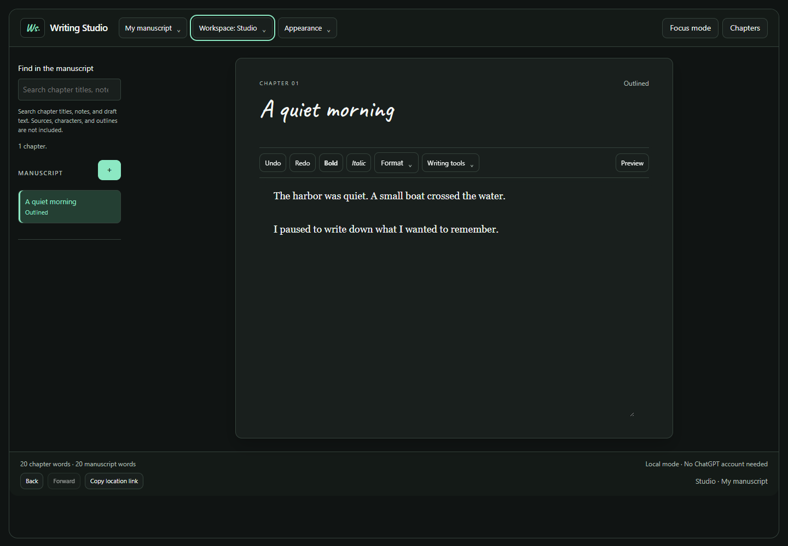
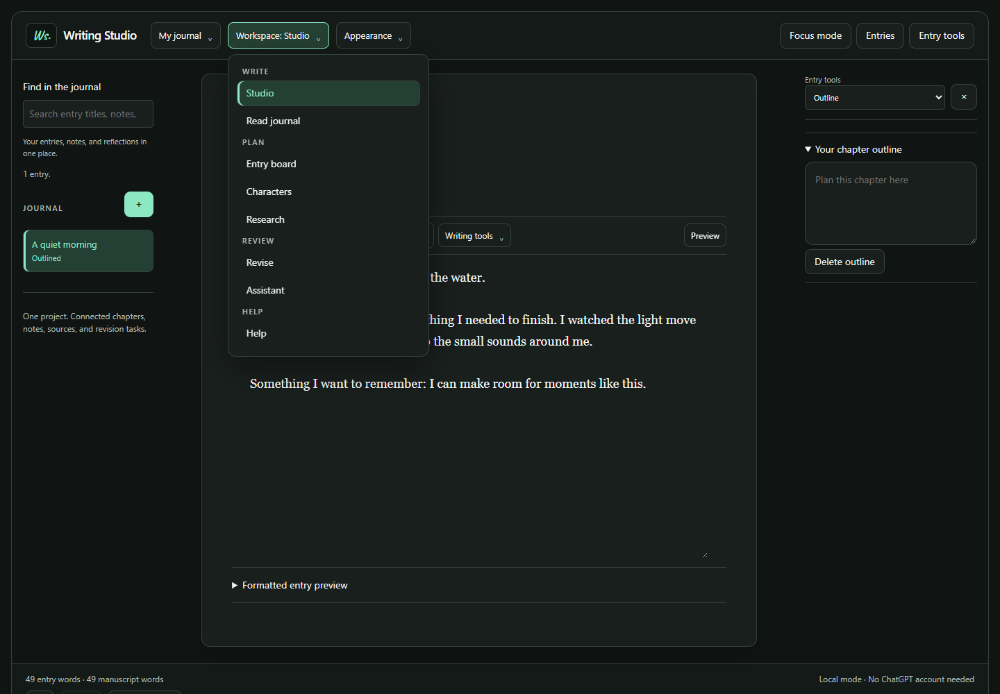

# Writing Studio

Writing Studio is a private writing workspace for fiction, nonfiction, memoir, poetry, screenplays, essays, and academic work. Its mint charcoal theme pairs white manuscript text with handwritten chapter titles and a soft mint glow that fades after each typed letter. A narrower writing pane keeps lines comfortable to read, with grouped navigation above and a clear writing area. Writing, local backups, and exports work without an account or internet connection.

Version **0.6.0-beta** adds Journaling with editable entry titles and original creation dates, silent background autosave, stable text sizing while typing, a compact sticky writing toolbar, and a mobile chapter/entry list drawer. The list visibility persists across reloads, project dialogs return keyboard focus correctly, and formatting buttons expose selection state. The mint and near-black design, optional typing glow, existing manuscripts, and local backup format are preserved.

[Source repository](https://github.com/AuroraX98/Writing-Studio) · [Version 0.6.0-beta downloads](https://github.com/AuroraX98/Writing-Studio/tree/main/downloads)

Download: [Windows ZIP](https://github.com/AuroraX98/Writing-Studio/raw/refs/heads/main/downloads/Writing-Studio-0.6.0-beta-windows.zip) · [Mac ZIP](https://github.com/AuroraX98/Writing-Studio/raw/refs/heads/main/downloads/Writing-Studio-0.6.0-beta-mac.zip) · [Source ZIP](https://github.com/AuroraX98/Writing-Studio/raw/refs/heads/main/downloads/Writing-Studio-0.6.0-beta-source.zip)

## Local mode — no ChatGPT account needed

The downloaded app runs independently on your computer. **No ChatGPT account, ChatGPT subscription, Writing Studio account, or GitHub sign-in is required to use it.** Local mode is the default: open the app and start writing. You do not need Codex or ChatGPT running alongside it.

Writing, browser autosave, character profiles, the bundled thesaurus, and exports work without internet access. The launcher also provides automatic local folder backups. Your workspace stays in this browser and your backup files; there is no account-based cloud synchronization.

External research links need internet access to open their websites.





These screenshots show the running app with an original fictional sample manuscript.

## Open the app

Extract the entire download into a folder first. On Windows, double-click **Open Writing Studio.bat**. On Mac, double-click **Open Writing Studio.command**. The launcher opens your browser at **http://127.0.0.1:8766/**. Keep the launch window open while writing and use the same browser and address each time.

**Python 3.8 or newer must be installed for the launcher and automatic folder backups.** The Mac launcher finds Python on your PATH. The Windows launcher checks `py -3`, `python`, and `python3`. If Python is unavailable, open **Writing Studio.html** in a current browser and use downloaded JSON backups. Do not remove the `app` folder when using a launcher.

The standalone HTML edition stores its workspace in browser storage. Storage for files opened directly from your computer varies by browser; moving or renaming the file may create a different workspace. Keep it in the same location, use the same browser, and download backups frequently. Use **Import** to move projects between browsers or computers.

The font selector inside **Format** above the draft includes Caveat (handwritten), Chalkboard, serif and modern options, and Georgia, Palatino, Garamond, Times New Roman, Courier New, Trebuchet, and Verdana. These choices change draft and in-app reading text. Caveat is bundled for offline use. Other manuscript fonts use local system fallbacks, so their exact appearance varies by computer; exports keep their book typography. Handwritten chapter headings use the bundled Caveat font, which works offline.

**Appearance → Colors** opens an optional live color preview. Enable custom colors, choose a solid background or a three-color soft gradient, and adjust hue, intensity, brightness, and gradient direction. Writing panels adapt to your selected light or dark theme for readability. **Save colors** keeps your choices; Cancel or Escape restores the previous palette. **Restore original colors** previews the original theme without changing your other settings. Appearance also contains the theme selector and **Typing glow** switch.

## Find your way around

The workspace shows your current view and project. **Back** and **Forward** revisit chapters and views within the app; your browser's navigation buttons also work. **Copy location link** records the current project, chapter, and view in the browser address. A location link opens that spot only when the same projects are available at the same app address in the same browser. It does not transfer your writing or create a public sharing link. When returning during a session, the app restores the view's search, open panels, scroll position, and available keyboard focus.

The project-name dropdown contains project switching, creation, import, backups, export, and Trash. **Workspace** groups Studio and Read manuscript under Write; Characters and Research under Plan; and getting-started guidance under Help. **Appearance** holds visual preferences. The same menus work on narrow screens. Use **Chapters** (or **Entries** for Journaling) to open or close the list, or **Focus mode** to clear it away. On narrow screens, the list opens as a drawer; closing it returns you to the same caret and scroll position. The former Chapter/Entry tools panel and all of its controls have been removed from every project type. Existing notes, outlines, ideas and saved passages remain in project data and full backups. Keyboard users can use **Skip to workspace** and **Skip to draft** before the main controls.

**Help** includes an optional first-session guide and direct links to Studio, Folder backups, and Export. Chapter search shows matching text and **Clear search** brings back the full list.

## Write and organize

The writing page keeps the title and draft together without a settings panel or a second preview section. Change Genre / approach in the project-name menu; delete the current entry or chapter from the toolbar’s Tools menu. Existing saved status and synopsis data remain in your project. The compact toolbar stays within reach while you scroll a long draft. **Format** contains font, size, alignment and spacing; Bold, Italic, Undo, Redo and Preview remain close by. **Writing tools** groups typing help, dictionary, thesaurus, and shortcuts. Each newly typed letter receives a mint glow that fades over 1.5 seconds while the letter stays visible; pasting and reopening a chapter do not animate the whole passage.

Choose **New project** from the project-name dropdown, enter a name, and select Journaling, Fiction, Nonfiction, Memoir, Poetry, Screenplay, Essays, or Academic. Add chapters with the **＋** button. Choose among 43 genres and approaches across eight project types. Journaling uses dated, freely titled entries; the other types use chapters.

Drafts, titles, and research records autosave after a half-second pause. Routine saving is silent and does not change the layout. **Project → Save details** shows the current status on demand. Save failures remain visible with a Download a backup recovery action. Ordinary closing flushes pending browser changes. A second window changing the same browser workspace pauses saving to protect it.

Select words in the draft and click **Bold** or **Italic**. Formatting appears in the toolbar **Preview**, whole manuscript reading, and formatted exports; the typing area displays plain text. Each chapter remembers its left, right, or justified alignment and Compact, Comfortable, or Double line spacing. **Undo** and **Redo** handle draft edits and formatting during the current session. Download a full project backup to keep a lasting copy.

**Personal dictionary** protects your names and unusual words from the app's typing corrections. It also lets you restore removed words. Browser spelling underlines use your browser's own dictionary. The bundled English typing help offers a small list of common typo corrections, including `Ca n` → `Can`, `whta` → `what`, `thta` → `that`, `liek` → `like`, `becasue` → `because`, `bdy` → `body`, `knw` → `know`, and standalone `i` → `I` when you finish a word with a space, punctuation, or Enter; ambiguous word boundaries appear as suggestions. Sentence capitalization changes a completed first word after `.`, `?`, or `!`, including quoted sentences. It avoids common abbreviations, initials, numeric periods, URLs, and ellipses; these are conservative English rules rather than a full grammar checker. Existing text is not changed automatically. Single missing-letter guesses use 82,378 locally bundled English spelling entries, plus recognized regular inflections and appear as review choices, even in Autocorrect mode; the app does not choose an inferred word for you. Recognized words, personal dictionary entries, pasted text, and unfinished words do not produce missing-letter guesses. Inference checks alphabetic words of 3–32 letters, tries one inserted letter, and shows at most eight choices. It cannot reliably recover two missing letters or determine meaning from context. It is not a complete spelling dictionary. Use **Undo correction** to immediately reverse a correction.

**Offline thesaurus** uses the locally bundled WordNet 3.0 English word database. Select a word to explore synonyms grouped by meaning and part of speech, then choose a replacement yourself. Replacements preserve selected formatting and can be undone. Coverage varies by word; definitions and part-of-speech groups help you judge whether a synonym suits your sentence. It does not interpret the context for you, and it makes no external runtime requests.

**Delete** moves chapters, research records, character profiles, and projects to **Trash**. Restore brings them back; permanent deletion asks for confirmation. The last chapter is replaced by a blank chapter so writing can continue.

## Journal entries

Choose **New project → Project type → Journaling**. The Genre / approach selector shows **Journaling**. Entries begin as **Untitled entry**; type any title in the heading and use **＋** to add another entry. An existing project can also switch to Journaling from its Project type menu without renaming or removing its writing.

Each newly created entry records its original creation instant. Its date and time appear beneath the title in your device's local time, in Read journal, and in all five manuscript export formats. Full backups preserve the timestamp through import and Trash recovery. Editing or renaming does not change it. Older entries without recorded creation dates say the date is unavailable; the app never invents an old creation time.

No chapter sequence or title is required.

## Keep character profiles

Open **Characters** to keep a separate collection for each project. Add a name and role, then describe appearance, traits, habits, beliefs, goals, fears, relationships, backstory, character arc, and notes. Search works across names, roles, and all profile details. Edits autosave, and deleted profiles move to Trash for recovery.

Full JSON backups include character profiles. Manuscript exports keep chapter text and exclude these private profiles.

## Read your work

**Read manuscript** displays all chapters in order, with a chapter jump list and buttons to return to editing. Private notes and research do not appear in this reading view or manuscript exports.

| Shortcut | Action |
| --- | --- |
| Ctrl/Cmd+B or Ctrl/Cmd+I | Bold or italic selected draft text |
| Ctrl/Cmd+Z | Undo draft edit |
| Ctrl/Cmd+Shift+Z; Ctrl+Y | Redo draft edit |
| Ctrl/Cmd+S | Save current changes |
| Ctrl/Cmd+Shift+R | Read the manuscript |

## Keep recoverable copies

Browser storage is the working copy. Clearing browser data removes it, and a full disk or browser storage limit can prevent saving. The app reports failures and keeps a previous valid browser copy when possible. A backup is an additional copy; keep one on another drive for protection against a lost or damaged computer.

With the launcher running, **Folder backups** saves complete project JSON copies outside browser storage. The separate folder indicator shows the last successful backup and any failure. By default, copies go to:

- Windows: `%LOCALAPPDATA%\Writing Studio\Backups`
- Mac: `~/Library/Application Support/Writing Studio/Backups`
- Linux when running Python directly: `~/.local/share/writing-studio/backups`

If the new Writing Studio folder does not exist and an older Writing Desk backup folder is present, the launcher reuses that older folder. Existing copies stay in place; the app does not move or delete them during the rename. The folder shown in the app is the folder actually in use.

`latest.json` updates after edits are saved. `previous.json` retains the preceding changed copy. Dated recovery snapshots are written on the first changed save and when at least five minutes have passed since the last snapshot; this is an edit-driven schedule, so idle time does not create extra copies. **Back up now** forces a dated copy. The newest 50 dated snapshots are kept, in addition to latest and previous. Writes use temporary files and atomic replacement.

If an existing folder copy differs from the browser's workspace, automatic folder saving pauses until you choose **Import latest backup** or **Use this workspace**. Importing adds separate project copies. A stale window cannot silently replace a newer folder backup; use the visible recovery controls when a conflict occurs. The app never automatically replaces the browser workspace with a disk copy.

**Back up projects** downloads a JSON file containing every project, character profiles, notes, research, versions, dictionary, and Trash. **Import** restores JSON backups as separate copies, or imports TXT and Markdown source as a chapter. Markdown import retains its source text rather than converting its formatting. Research URLs are saved references; keep excerpts in your records for offline reading.

To choose a different backup folder or local address, run Python directly:

```text
python3 launch.py --backup-dir "/path/to/your/backup-folder" --port 8767
```

On Windows, use `py -3` and a Windows folder path instead of `python3`. Changing the port changes the browser storage address; import a backup to transfer your workspace. Close an old launcher before starting the updated app.

## Export your manuscript

**Export** offers PDF, Word (.docx), Markdown (.md), TXT (.txt), and a standalone HTML reading copy. Chapter titles and draft text follow manuscript order; private notes and character profiles remain in full JSON backups.

Word, PDF, and HTML preserve bold, italic, alignment, and line spacing. Markdown includes bold and italic markup, but visual alignment and line spacing depend on the reader. TXT preserves words and paragraph breaks without formatting. Direct PDF includes a bundled serif font, page numbers, wrapping, and chapter page breaks. If a character is outside that font, the app reports it; use **Print / save as PDF** for browser font support.

The Chapter/Entry board, Revise, and Assistant features have been removed, including their menus, keyboard shortcuts, and local provider integration. Old location links open Studio on the same project and chapter. Existing notes, saved versions, revision tasks, and assistant drafts remain in full backups for compatibility; updating does not erase that data.

## Build and check the source

The source download includes generated runtime files and their build inputs. To regenerate `app/index.html`, `app/main.js`, `app/styles.css`, and `Writing Studio.html`, run:

```text
python3 work/build_app.py
```

The WordNet data is already bundled, so ordinary builds need no downloads. To regenerate that data, `work/build_thesaurus.py` takes the WordNet 3.0 database archive, full archive for word exceptions, and license file downloaded separately by the developer. Its help and source list the inputs and their official URLs. The script itself makes no network calls, and the writing app never downloads thesaurus data at runtime.

Run checks from the project folder with Python 3.8+ and Node.js available:

```text
node --test tests/storage.test.cjs
node tests/export.test.cjs
node tests/pdf.test.cjs
node tests/text-tools.test.cjs
node --test tests/autocorrect.test.cjs
node tests/local-backup.test.cjs
node tests/thesaurus.test.cjs
node --test tests/theme-palette.test.cjs
node --test tests/genres.test.cjs
python3 -m unittest discover -s tests -p test_local_backup.py -v
```

Checks cover storage and recovery, invalid imports, Trash, formatted exports, alignment, formatting edits, dictionary storage, backup conflicts, atomic writes, retention, and local request boundaries. Browser checks cover the remaining navigation, retired links, autosave, exports, accessibility, and narrow layouts. Checks use isolated sample data.

After rebuilding, create curated downloads with:

```text
python3 work/package_release.py
```

The packaging script checks archive integrity and excludes working backups and scratch files. Downloads include the selected app preview above. The script does not upload anything to GitHub.

## Current limits and licensing

This is a beta browser app with launch scripts, rather than an installed desktop application. Nested scenes, attached research files, anchored comments, DOCX import, EPUB, full offline spelling dictionaries, and cross-device synchronization are future work. Undo history is per session; JSON backups are persistent. Keep a backup before updating, and import it when moving to a new browser or address.

The application source is available under the [MIT License](LICENSE). Bundled assets retain their own licenses: the handwritten Caveat font uses the SIL Open Font License in `app/vendor/Caveat-OFL.txt`, the PDF font's license is in `app/vendor/DejaVu-LICENSE.txt`, and the English thesaurus data license is in `app/vendor/WordNet-LICENSE.txt`.
